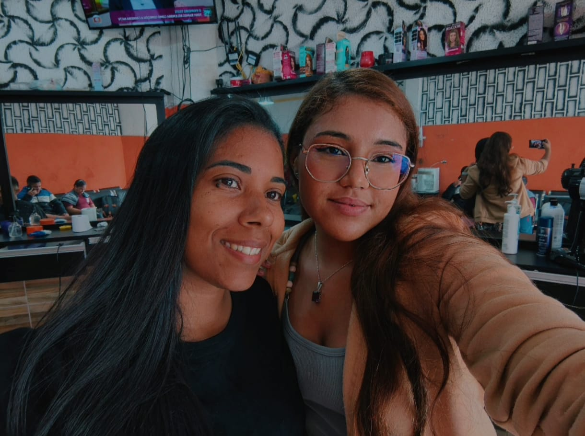
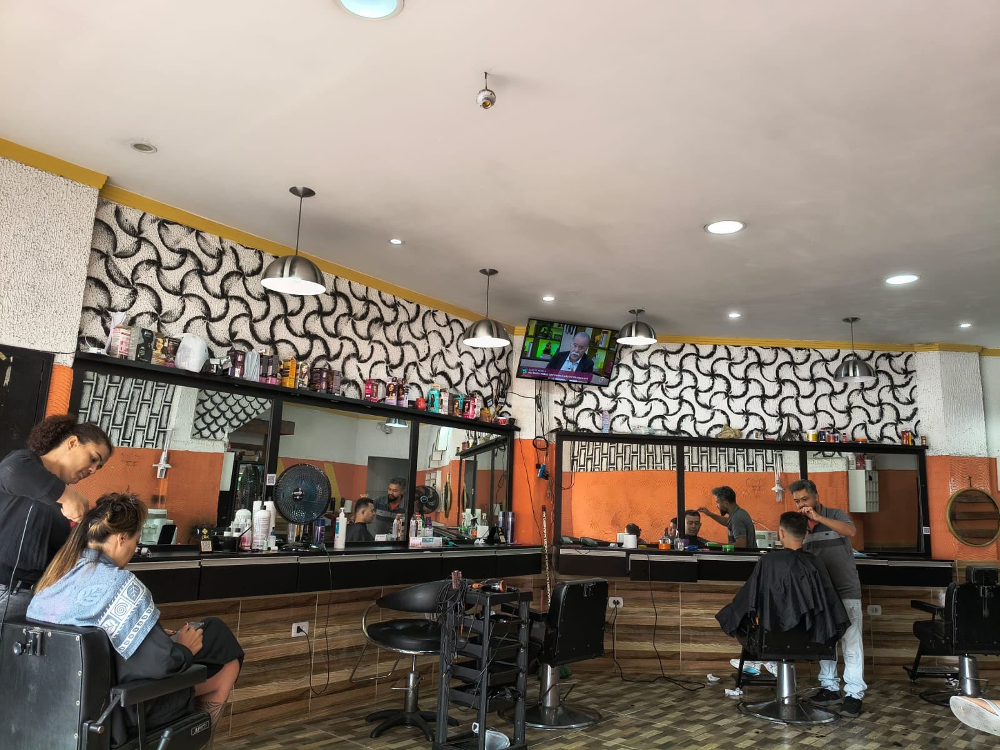
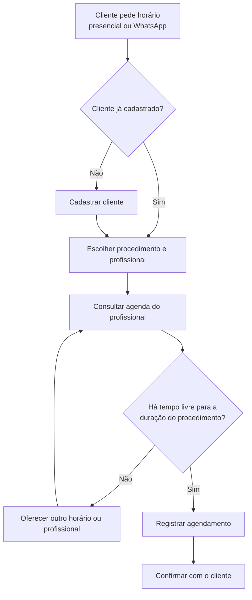
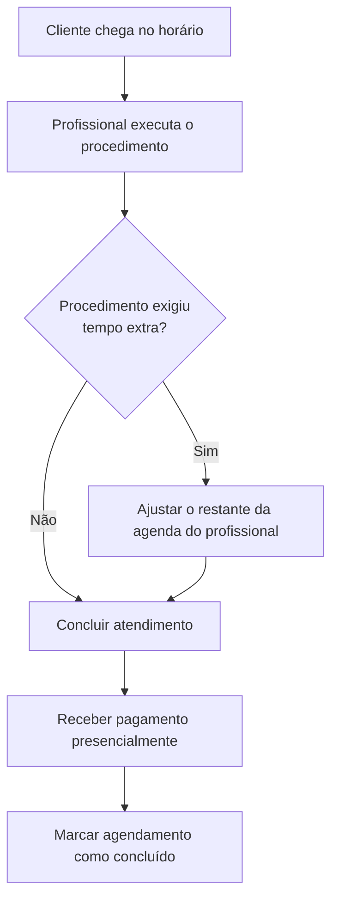
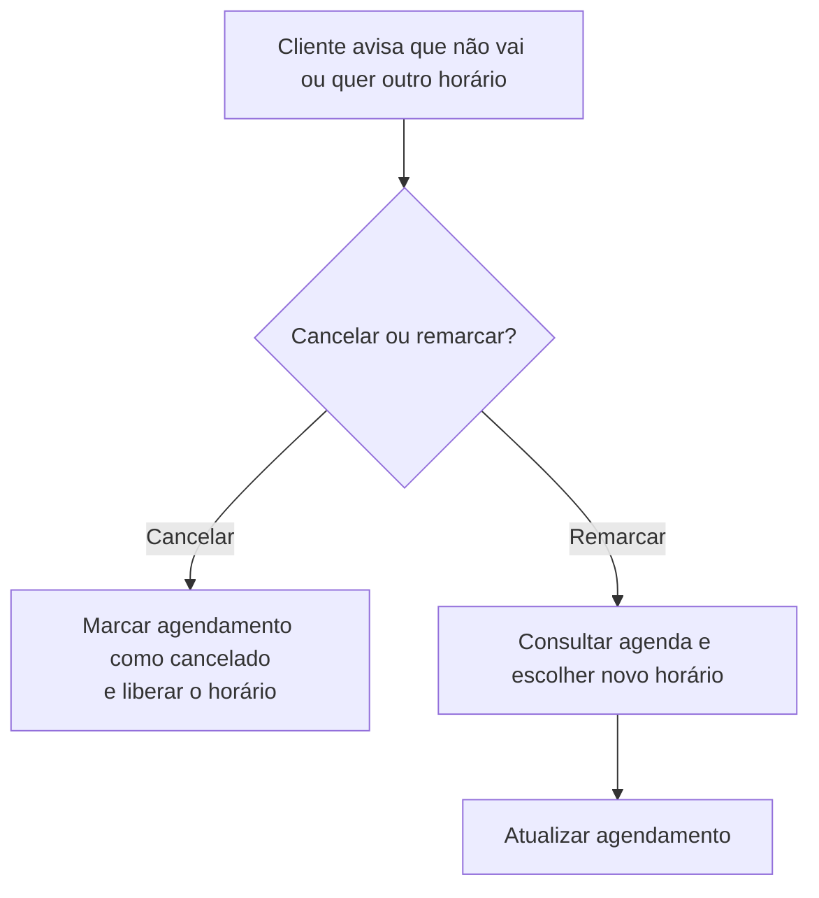
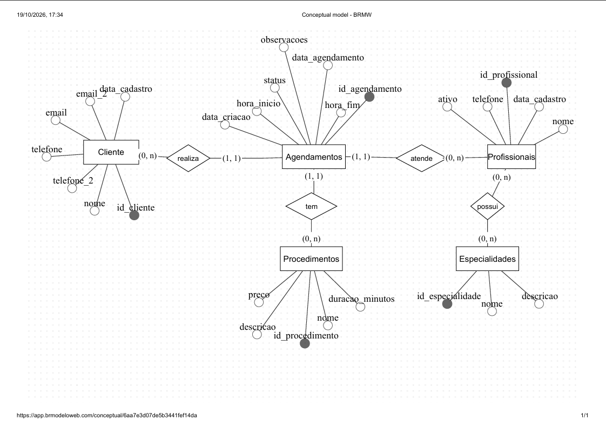
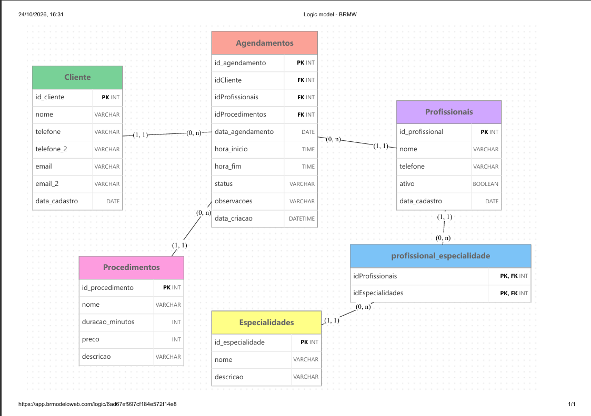

# Entrega 1 — Modelo Conceitual (DER)
### Modelagem de um sistema de gestão de informações para uma organização de pequeno porte

---

## Metadados

- **Nomes dos alunos e RGM**
  * Emilly Rodrigues de Souza — RGM: 47508248
  * Franciele Souza de Jesus — RGM: 47643323
  * Julia Parra — RGM: 47566604
  * Kamilly Vitória Alves da Silva — RGM: 46919431

---

## 1. Caracterização da Organização

- **Nome e natureza da organização:** Salão dos Primos — salão de beleza (feminino e masculino), organização **com fins lucrativos**.
- **Contexto e porte:** Operação de pequeno porte, com **4 profissionais** e um público de **30 a 50 clientes**. O volume de atividade é composto principalmente por agendamentos e execução de procedimentos de beleza (corte, coloração, progressiva, entre outros).
- **Problemas e necessidades identificados:** A principal "crise operacional" está no **controle de horários**, feito hoje em **caderno de papel**. Isso gera dois problemas centrais:
  1. Falta de visibilidade da agenda: o cliente precisa ir ao salão pessoalmente para saber se há horário e pode descobrir que não há vaga só ao chegar.
  2. Sobrecarga do WhatsApp dos funcionários, usado tanto para marcar horários quanto para tirar dúvidas durante o expediente. Com o salão cheio, as mensagens ficam de lado, as respostas atrasam e o profissional perde o foco no atendimento.
- **Justificativa da escolha:** O Salão dos Primos é uma organização real, de porte adequado à disciplina: pequena o bastante para ser modelada nesta etapa, mas com processos, entidades e regras suficientes (clientes, procedimentos, profissionais, agendamentos, restrições de tempo). O grupo tem acesso direto ao salão para entrevistas e observação no local.
- **Evidências da organização:**
  * Endereço: R. Bernardino Vergueiro, 276 — Jardim Jaú (Zona Leste), São Paulo - SP, 03710-060
  * Instagram: <https://www.instagram.com/salaodosprimoss/>
  * Google Meu Negócio: <https://www.google.com/searchviewer/10?svid=CAwSHRIbCgNwdnESFENnMHZaeTh4TVdZeWQyYzNkR3R4GAo>
  * Telefone de contato: (11) 94400-0738
  * Responsável pela organização: Alaide
  * Pesquisa de campo: entrevista com a responsável e observação dos processos dentro do salão.
  * Fotos da visita de campo:

  
  

---

## 2. Processos de Negócio

- **Principais processos mapeados:**
  1. **Cadastro de clientes** — registro dos dados básicos de contato na primeira visita.
  2. **Marcação de horário** — registro do agendamento do cliente (hoje em caderno).
  3. **Organização da agenda** — manutenção do caderno com nomes e horários, evitando conflitos.
  4. **Contato e confirmação com o cliente** — presencial e por WhatsApp, para marcar, confirmar ou tirar dúvidas.
  5. **Cancelamento e remarcação** — alteração de um horário já marcado feito pelo WhatsApp com antecedencia.
  6. **Atendimento / execução do procedimento** — realização do serviço (corte, coloração, progressiva etc.), cada um com duração própria.
  7. **Recebimento do pagamento** — feito presencialmente, ao final do atendimento; o valor varia com o tamanho do cabelo do cliente, por isso é combinado no salão, aceita debito, credito, pix e dinheiro. 
  8. **Venda de produtos no salão** — O salão não faz venda de produtos.
  9. **Compra de produtos e insumos** — reposição de tintas e produtos químicos usados pelos profissionais através de fornecedores.
  10. **Comissão dos profissionais e fechamento de caixa** — Todos os profissionais devem tirar 30% do que receberam para despesas do salão, os outros 70% são dos próprios profissionais.

- **Fluxo de cada processo e integração entre eles:**
  * O **cadastro do cliente** vem antes da **marcação de horário**: todo agendamento pertence a um cliente.
  * A **marcação de horário** depende da **organização da agenda**: é preciso consultar o caderno e verificar se há tempo livre compatível com a duração do procedimento.
  * O **contato com o cliente** alimenta a marcação, a confirmação e o **cancelamento/remarcação**, e compete pela atenção do profissional com o **atendimento em andamento**.
  * O **atendimento** consome o tempo reservado na agenda; procedimentos longos (ex.: coloração para loiro, que leva o dobro do tempo por causa da cor natural do cabelo) precisam ser considerados já na marcação.
  * Ao fim do atendimento ocorre o **recebimento do pagamento**, que alimenta o fechamento de caixa e a comissão dos profissionais.
  * Os **insumos** usados no atendimento dependem da compra e do controle de estoque.

- **Fluxogramas (opcional)** (renderizados pelo GitHub):

**Marcar horário**

**Atendimento e pagamento**

**Cancelar ou remarcar**

---

## 3. Requisitos do Sistema

### 3.1 Requisitos Funcionais

- RF01. Permitir **cadastrar clientes**, com dados básicos de contato.
- RF02. Permitir **cadastrar procedimentos** oferecidos pelo salão, incluindo a duração estimada de cada um.
- RF03. Permitir **cadastrar os profissionais** do salão.
- RF04. Permitir **cadastrar especialidades** e vincular cada profissional às especialidades que domina.
- RF05. Permitir **registrar um agendamento**, escolhendo cliente, profissional, procedimento, data e horário de início.
- RF06. O sistema deve **calcular o horário de término** do agendamento a partir da duração do procedimento.
- RF07. O sistema deve **impedir agendamentos que se sobreponham** na agenda do mesmo profissional.
- RF08. Permitir **consultar a agenda** (por dia, por profissional) para saber quais horários estão livres, substituindo a necessidade de o cliente ir ao salão perguntar pessoalmente.
- RF09. Permitir **cancelar ou remarcar** um agendamento existente.
- RF10. Permitir **consultar o histórico de atendimentos** de um cliente.
- RF11. Permitir **marcar um profissional como inativo**, impedindo novos agendamentos para ele.

### 3.2 Requisitos Não Funcionais

- RNF01. **Usabilidade:** interface simples, já que os usuários (profissionais do salão) não têm necessariamente familiaridade avançada com tecnologia; registrar um horário deve ser tão rápido quanto anotar no caderno.
- RNF02. **Desempenho:** a consulta de horários disponíveis deve responder rapidamente em horários de pico, quando o salão está cheio.
- RNF03. **Segurança/privacidade:** dados de contato dos clientes devem ser protegidos e não expostos publicamente, em conformidade com a LGPD.
- RNF04. **Disponibilidade:** o sistema deve estar acessível durante o horário de funcionamento do salão e, idealmente, também fora dele, para permitir consulta remota de horários.
- RNF05. **Confiabilidade:** o sistema deve evitar conflitos de agenda (dois clientes no mesmo horário com o mesmo profissional), que é a maior fonte de problema com o caderno.

---

## 4. Regras de Negócio

- **Regras operacionais:**
  * RN01. Um horário só pode ser marcado se houver tempo livre compatível com a duração do procedimento (ex.: coloração para loiro exige o dobro do tempo de um procedimento padrão).
  * RN02. Um profissional não pode ter dois agendamentos com intervalos de tempo sobrepostos.
  * RN03. Nenhum cliente pode perder o horário reservado para dar lugar a outro cliente com procedimento mais longo; a ordem e a duração reservada devem ser respeitadas.
  * RN04. Profissional inativo não pode receber novos agendamentos.
  * RN05. Todo agendamento pertence a exatamente um cliente, um profissional e um procedimento.
  * RN06. O preço cadastrado no procedimento é apenas um valor de referência: o valor final varia com o tamanho do cabelo e é combinado e pago presencialmente no salão.
  * RN07. Um agendamento cancelado libera o horário na agenda do profissional.
  * RN08. O cliente deve solicitar o cancelamento do agendamento pelo WhatsApp com a antecedência mínima definida pelo salão.
- **Restrições organizacionais:**
  * **LGPD (Lei 13.709/2018):** telefone e e-mail dos clientes são dados pessoais; o modelo deve permitir proteger esses dados e limitar quem pode vê-los. Por isso o dicionário marca esses atributos como protegidos.
  * **Normas sanitárias:** o salão usa produtos químicos e instrumentos que exigem higienização, conforme as exigências da vigilância sanitária. 
  * **Equipe pequena e pouco familiarizada com tecnologia:** o sistema precisa ser simples e rápido de usar durante o expediente, o que limita o número de campos obrigatórios nos cadastros.
  * **Nota fiscal:** O salão emite nota fiscal.

---

## 5. Dicionário de Dados Conceitual (Preliminar)

**Os exemplos de valores são fictícios**, apenas para ilustrar o tipo de informação; não representam clientes ou dados reais do salão.

O dicionário completo está em [dicionario_de_dados.html](dicionario_de_dados.html).

### Entidade: Cliente
Pessoa que agenda e recebe os serviços do salão.

| Atributo | Descrição | Regra de negócio associada |
|----------|-----------|----------------------------|
| id_cliente (PK) | Identificador único do cliente | Obrigatório, gerado pelo sistema |
| nome | Nome do cliente | Obrigatório |
| telefone | Contato principal para confirmação de agendamentos | Obrigatório; dado pessoal, deve ser protegido (LGPD) |
| telefone_2 | Telefone alternativo | Opcional; dado pessoal, deve ser protegido |
| email | E-mail principal | Opcional; dado pessoal, deve ser protegido |
| email_2 | E-mail alternativo | Opcional; dado pessoal, deve ser protegido |
| data_cadastro | Data em que o cliente foi cadastrado | Gerado automaticamente |

### Entidade: Profissionais
Pessoas que executam os procedimentos no salão.

| Atributo | Descrição | Regra de negócio associada |
|----------|-----------|----------------------------|
| id_profissional (PK) | Identificador único do profissional | Obrigatório, gerado pelo sistema |
| nome | Nome do profissional | Obrigatório |
| telefone | Contato do profissional | Opcional; dado pessoal, deve ser protegido |
| ativo | Indica se o profissional atua no salão (verdadeiro/falso) | Obrigatório; inativo não recebe novos agendamentos (RN04) |
| data_cadastro | Data de cadastro do profissional | Gerado automaticamente |

### Entidade: Especialidades
Áreas de atuação que um profissional domina.

| Atributo | Descrição | Regra de negócio associada |
|----------|-----------|----------------------------|
| id_especialidade (PK) | Identificador único da especialidade | Obrigatório, gerado pelo sistema |
| nome | Nome da especialidade (ex.: coloração, corte, tratamentos capilares) | Obrigatório; não pode se repetir |
| descricao | Descrição da especialidade | Opcional |

### Entidade associativa: profissional_especialidade
Aparece apenas no modelo lógico: resolve o relacionamento N:N `possui` entre Profissionais e Especialidades.

| Atributo | Descrição | Regra de negócio associada |
|----------|-----------|----------------------------|
| idProfissionais (PK, FK) | Profissional que possui a especialidade | Obrigatório |
| idEspecialidades (PK, FK) | Especialidade que o profissional possui | Obrigatório; a combinação profissional + especialidade não pode se repetir |

### Entidade: Procedimentos
Serviços de beleza oferecidos pelo salão.

| Atributo | Descrição | Regra de negócio associada |
|----------|-----------|----------------------------|
| id_procedimento (PK) | Identificador único do procedimento | Obrigatório, gerado pelo sistema |
| nome | Nome do procedimento (ex.: corte, progressiva, coloração) | Obrigatório |
| duracao_minutos | Duração média, em minutos | Obrigatório; define o tamanho do bloco de agenda (RN01) |
| preco | Valor de referência do procedimento | Opcional; o valor final varia com o tamanho do cabelo (RN06) |
| descricao | Descrição do procedimento | Opcional |

### Entidade: Agendamentos
Evento no tempo que une cliente, profissional e procedimento.

| Atributo | Descrição | Regra de negócio associada |
|----------|-----------|----------------------------|
| id_agendamento (PK) | Identificador único do agendamento | Obrigatório, gerado pelo sistema |
| data_agendamento | Data do atendimento | Obrigatório |
| hora_inicio | Horário de início | Obrigatório; não pode sobrepor outro agendamento do mesmo profissional (RN02) |
| hora_fim | Horário previsto de término | Calculado: hora_inicio + duracao_minutos do procedimento |
| status | Situação (marcado, concluído, cancelado) | Obrigatório |
| observacoes | Observações sobre o atendimento | Opcional |
| data_criacao | Data e hora do registro | Gerado automaticamente |
| idCliente (FK) | Cliente do agendamento | Obrigatório |
| idProfissionais (FK) | Profissional que atenderá | Obrigatório; deve estar ativo (RN04) |
| idProcedimentos (FK) | Procedimento a ser realizado | Obrigatório |

---

## 6. Modelagem Conceitual (Entidades, Atributos, Relacionamentos)

- **Entidades reconhecidas** (com os mesmos nomes do DER):
  * **Cliente** — quem agenda e recebe o serviço; foi apontado pela responsável como dado que precisa ser registrado.
  * **Profissionais** — quem executa o procedimento; necessário para controlar a agenda individual e evitar conflitos.
  * **Procedimentos** — serviços oferecidos; sua duração determina as regras de agendamento relatadas na entrevista.
  * **Agendamentos** — evento que conecta Cliente, Profissionais e Procedimentos em data e horário; é o núcleo do problema relatado (controle de horários em papel).
  * **Especialidades** — áreas que cada profissional domina, para melhorar a escolha do cliente.
- **Atributos e classificações:** detalhados no dicionário de dados (Seção 5). Todas as entidades têm identificador (PK).
- **Relacionamentos** *(cardinalidades no formato (mínimo, máximo), na convenção do BRModelo: o par escrito ao lado de uma entidade indica quantas ocorrências dela se relacionam com uma ocorrência da outra entidade)*:
  * **Cliente realiza Agendamentos:** um Cliente realiza de zero a vários Agendamentos — par ao lado de Agendamentos: (0,n) — e cada Agendamento é realizado por exatamente um Cliente — par ao lado de Cliente: (1,1). Relacionamento 1:N.
  * **Agendamentos atende Profissionais:** um Profissional atende de zero a vários Agendamentos — Agendamentos (0,n) — e cada Agendamento é atendido por exatamente um Profissional — Profissionais (1,1). Relacionamento 1:N.
  * **Agendamentos tem Procedimentos:** um Procedimento consta em zero ou vários Agendamentos — Agendamentos (0,n) — e cada Agendamento tem exatamente um Procedimento — Procedimentos (1,1). Relacionamento 1:N.
  * **Profissionais possui Especialidades:** um Profissional possui zero ou várias Especialidades — Especialidades (0,n) — e uma Especialidade é possuída por zero ou vários Profissionais — Profissionais (0,n). Relacionamento N:N, resolvido no modelo lógico por uma tabela associativa.
- **Restrições e políticas aplicadas ao modelo:**
  * Um agendamento só é válido se o intervalo hora_inicio–hora_fim não colidir com outro do mesmo profissional (RN02, RN03).
  * A duração do procedimento define o bloco de tempo reservado (RN01).
  * Dados pessoais de Cliente e Profissionais são marcados como protegidos (LGPD).

---

## 7. Diagrama Entidade-Relacionamento (DER)

**DER Conceitual:** [DER_Conceitual.png](DER_Conceitual.png)

**DER Lógico:** [DER_Lógico.png](DER_Lógico.png)

- O DER conceitual (feito no BRModelo) representa as 5 entidades (Cliente, Agendamentos, Profissionais, Procedimentos, Especialidades), todos os atributos com os identificadores marcados e as cardinalidades (mín,máx) dos dois lados, **idênticas às da Seção 6 e do dicionário**.
- **Como ler as cardinalidades:** o par escrito ao lado de uma entidade indica quantas ocorrências dela se relacionam com uma ocorrência da outra entidade. Exemplo: `(1, 1)` ao lado de Cliente e `(0, n)` ao lado de Agendamentos em `realiza` significa que cada agendamento tem exatamente um cliente e que um cliente pode ter de zero a vários agendamentos.
- O DER lógico deriva do conceitual:
  * cada relacionamento 1:N vira chave estrangeira na tabela do lado "N", ou seja, em Agendamentos: `idCliente` (→ Cliente), `idProfissionais` (→ Profissionais) e `idProcedimentos` (→ Procedimentos);
  * o N:N `possui` entre Profissionais e Especialidades vira a tabela associativa **profissional_especialidade**, cuja chave primária é composta por `idProfissionais` e `idEspecialidades` (ambas também chaves estrangeiras), o que impede repetir a mesma combinação;
  * os atributos recebem tipos de dados compatíveis com o conteúdo (texto, número inteiro, data, data e hora, hora e booleano).
- O modelo é **escalável**: novas entidades (Pagamento, Produto/Insumo, Fornecedor, Avaliação do atendimento) podem se ligar a Agendamentos ou Cliente sem quebrar a estrutura atual.

---

## 8. Justificativa Técnica

O modelo **separa Cliente, Profissionais e Procedimentos** em entidades independentes, em vez de misturar esses dados em Agendamentos, porque cada um tem ciclo de vida e atributos próprios, reutilizados em vários agendamentos (um cliente volta várias vezes; um procedimento é feito por vários clientes). Isso evita repetição de dados e permite consultas como "histórico de um cliente" ou "agenda de um profissional".

**Agendamentos** é entidade própria, e não atributo de Cliente ou Profissionais, porque representa um **evento no tempo** com atributos próprios (data, início, fim, status) e é onde se aplicam as regras mais críticas, como o conflito de horários relatado na entrevista. As cardinalidades 1:N foram escolhidas porque, pelo relato de campo, cada agendamento envolve exatamente um cliente, um profissional e um procedimento, e um profissional não atende dois clientes ao mesmo tempo. Por isso, no DER, o par ao lado de Cliente, Profissionais e Procedimentos é (1,1) e o par ao lado de Agendamentos é (0,n): cada agendamento tem exatamente um de cada, enquanto um cliente novo, um profissional recém-contratado ou um procedimento ainda não realizado existem sem nenhum agendamento.

**Especialidades** é entidade própria, e não campo de texto em Profissionais, para padronizar os nomes das áreas e permitir filtrar profissionais por especialidade no futuro. O relacionamento é **N:N** porque um profissional pode dominar várias especialidades e uma especialidade é compartilhada por vários profissionais; no modelo lógico isso é resolvido pela tabela associativa, evitando atributos multivalorados. Por isso Profissionais não tem um atributo `especialidade`: ele seria redundante com o relacionamento.

A **duração** fica em Procedimentos, e não em Agendamentos, porque é característica do serviço (coloração para loiro sempre leva o dobro do tempo) e não varia a cada agendamento; assim a regra central fica em um único lugar, facilitando a manutenção. Já o `preco` em Procedimentos é só um valor de referência, pois o valor final varia com o tamanho do cabelo.

**Decisões de escopo desta entrega:** o grupo optou por modelar nesta etapa apenas o núcleo da agenda. O **pagamento** é feito presencialmente e o valor varia com o tamanho do cabelo, e os **materiais e insumos** (tintas, produtos químicos) são escolhidos pelos profissionais conforme cada cliente; por isso Pagamento, Produto/Insumo e Fornecedor ficaram fora desta primeira versão do DER. Os processos correspondentes foram mapeados na Seção 2, e o modelo foi pensado para recebê-los depois como novas entidades ligadas a Agendamentos, sem alterar o que já existe. 

---

## 9. Uso de Inteligência Artificial

| Item | O que registrar |
|------|------------------|
| **Ferramenta e etapa** | Claude (Anthropic). (1) Esboço inicial do README a partir do roteiro da entrevista. (2) Conferência de coerência entre README e DERs. (3) Revisão do README após a correção do professor (issue #19) e alinhamento final do README aos DERs do BRModelo. (4) Conferência dos DERs conceitual e lógico, exportados do BRModelo, contra o README e o dicionário. |
| **Motivação** | O grupo já tinha feito a entrevista de campo e queria organizar as respostas na estrutura exigida; depois, conferir a coerência entre README, dicionário e DERs e corrigir os pontos apontados pelo professor. |
| **Prompt(s) utilizados** | (1) "[Upload do roteiro de entrevista + template do trabalho] responda essas perguntas de acordo com esse pdf e me entregue o readme igual as instruções". (2) Pedido para comparar o README com os DERs. (3) "O repositório está do jeito que o professor pediu?", "pode refazer o README certo?" e "faz o README de acordo com eles" (com as imagens dos DERs anexadas). |
| **Resposta recebida** | (1) Versão incompleta do README, com respostas literais da entrevista e conteúdo proposto onde não havia resposta explícita. (2) Alinhamento de cardinalidades e do relacionamento Profissionais–Especialidades. (3) Comparação do repositório com a correção do professor, nova versão do README com processos, requisitos, regras, dicionário e justificativa ampliados e apontamento de inconsistências no DER lógico. |
| **Fontes consultadas e verificadas** | O esqueleto da entrega, o roteiro da entrevista com a Alaide, a observação no salão, a correção do professor (issue #19) e os DERs do próprio grupo. A IA não trouxe fontes externas. O grupo conferiu cada processo e regra novos com a responsável pelo salão e removeu o que o salão não pratica. |
| **Trechos rejeitados ou corrigidos** | Foram corrigidos manualmente entidades, dicionário de dados, requisitos, links das imagens e informações da organização. Itens sugeridos pela IA que o salão não confirmou foram descartados. |
| **Justificativa da escolha final** | O primeiro esboço tinha respostas genéricas e fora do padrão pedido; o grupo manteve apenas o que corresponde ao que foi observado e dito na pesquisa de campo, ao que o professor pediu e ao que está nos DERs. |
| **Reflexão crítica** | A IA alucinou bastante no esboço inicial e propôs regras e processos típicos de salões em geral, não necessariamente do Salão dos Primos; por isso tudo foi validado com a responsável. Todas as seções foram revisadas por pessoas do grupo. Na revisão dos DERs, a IA leu inicialmente as cardinalidades pela convenção contrária à do BRModelo e do professor e, por isso, afirmou que o conceitual estava coerente com o README; o erro apareceu quando o BRModelo gerou as chaves estrangeiras nas tabelas erradas, e então os rótulos foram invertidos no modelo conceitual, no lógico e no texto. |
